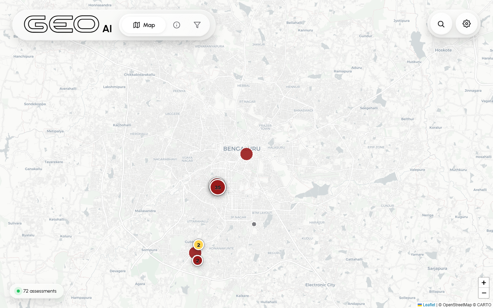
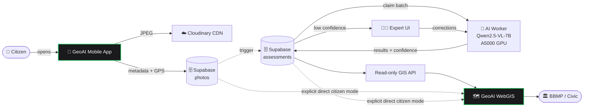

<div align="center">

# 🛣️ GeoAI

**Pavement Distress Detection System**

*Citizens snap photos of damaged roads — AI classifies each one — civic authorities see hotspots in real time.*

**[Existing hosted dashboard](https://gisgeoai.netlify.app/)** · Verify the hosted revision and data connection after each deployment.

[](LICENSE)
[](#)
[](#stack)
[](#authors)

<br/>



</div>

---

## 📍 Overview

GeoAI is an end-to-end civic-tech system that turns citizen smartphone photos into actionable road-maintenance intelligence. A two-stage vision-language model (Qwen2.5-VL-7B fine-tuned on RDD2022 + GAPs V2) classifies each photo into a **distress type** (longitudinal crack, transverse crack, alligator crack, pothole, block crack) with **severity** (Less / Moderate / Red Alert) and a **confidence score** read directly from raw model logits — not from string matching.

This repo holds the **three client-facing pieces** of that system:

| | What it does |
|---|---|
| 🗺️ **WebGIS** *(this repo's root)* | Civic-authority map using either the read-only GIS API or an explicitly configured direct citizen source, with shared filters, clusters, evidence, CSV and view links. Drive tracks and replay require the GIS API. |
| 📱 **Mobile** *(`mobile/`)* | Native Android capture client plus the bundled survey dashboard. Citizen observations connect through the existing public database configuration; an optional GIS server adds drive surveys. Native share, CSV save and camera/crop/upload remain available. |
| 🛣️ **iOS** *([`ios/`](ios/README.md))* | Native SwiftUI/MapKit dashboard and reporting plus a retained Video tab for the shared survey website, native share and CSV export. |

The AI pipeline, FastAPI server, expert-review UI, and Supabase schema live in the team's GPU-server repository — they're not in this repo.

---

## 🏗️ Architecture



> Components highlighted in green border are in **this** repo. Everything else is the team's broader system.

---

## 🗺️ Web Dashboard

Vanilla HTML/CSS/JS with no compilation step. Static hosting uses a small staging command to select the public files and data source. The original glass navigation and map layout remain; About opens from the GEOAI logo. The screenshot above is the original design reference.

### Features

- Six map styles prepare their current viewport behind the opening screen. A switch reuses a loaded renderer; failed providers have bounded fallback and leave a working map visible.
- Video starts as a camera icon, expands when selected, and adds only drive paths, actual distress and recorded kilometres. Its toggle never moves the map or opens another panel.
- Map mode shows walking/citizen observations. Video/drive mode hides those markers and photos, showing drive routes and their distress instead. Tapping Map restores citizen observations with their saved filters.
- Shared Filters: metadata-driven labels and severity, review state, confidence, inclusive IST dates, explicit day/night hours, citizen visibility and drive selection. Top Locations is available in Map mode.
- Filters use rounded, collapsible glass cards, larger selection pills and a persistent Clear filters action. Text action buttons use a consistent 16 px size with at least 44 px touch targets across navigation, Settings, drive inspection and replay. Both light and dark themes adapt to phone widths.
- The custom menu below total distance lists every recorded drive. Selecting a drive opens a right-side route and distress panel; click an observation to open its photo and details. All route lines and the full distance total remain visible when inspecting or replaying one drive; select All drives to return to the overview.
- **Replay drive** opens inside the persistent drive card and zooms to the car, with Play/Pause, distance seeking, speed controls and optional Follow. All stored frames are reachable through Previous/Next and the thumbnail gallery. Opening a photo keeps the controls available; large screens show image and details side by side, while phones stack them.
- Citizen and video observations use zoom-aware 40 px clusters. Numbered groups separate as you zoom in, remain stable when panning and preserve every observation. Coincident or maximum-zoom groups expose all member photos. Night halos and result counts remain intact.
- Click a result for an evidence preview, final labels, corrections, confidence, review state, IST time and position uncertainty. Full-resolution images require an explicit link.
- Optional drive comparisons show recorded kilometres, distressed metres and percentage, with sorting and explicit map focus.
- Export exactly the filtered current map area to CSV; copy a view link from Settings to restore camera, style, layers and filters.
- An on-demand metadata legend lives inside About; Settings contains map styles and Copy view link, with no separate Map legend button. Selected-drive evidence stays inside its drive card; citizen and All drives evidence retain the anchored previews and grouped View more list.

By default, citizen observations come from `/gis/citizen/assessments.geojson`. An explicit `dataSource: 'supabase'` configuration instead reads the original `photos` and `assessments` tables directly through the current map UI. Neither source silently substitutes the legacy snapshot or switches sources after an error. The supplied GIS sample has 131 default citizen observations, 344 including pending review, 164 distressed video segments and 4.06 km of recorded drives; those are frozen sample counts, not current live totals.

### Configuration and local preview

Recommended deployment: one HTTPS origin serving the API at `/gis/` and this folder at `/gis/app/`. In [`config.js`](config.js):

```js
window.GIS_CONFIG = { apiBase: "", shareBaseUrl: "" };
```

Leave these empty for same-origin GIS hosting. Separate static hosting in GIS mode needs a reachable HTTPS `apiBase` and API CORS permission. Android with a saved GIS server uses that API and requires CORS permission for `https://appassets.androidplatform.net`. iOS Video loads the deployed `/gis/app/` website. No live drive API origin is invented or embedded.

To use the original citizen database without a GIS server, explicitly configure the website with:

```js
window.GIS_CONFIG = {
  dataSource: 'supabase',
  supabaseUrl: 'https://YOUR_PROJECT.supabase.co',
  supabaseAnonKey: 'YOUR_PUBLIC_PUBLISHABLE_OR_ANON_KEY',
  shareBaseUrl: 'https://YOUR_PUBLIC_MAP_URL/'
};
```

Only a public publishable or anon key belongs in the client; secret/service-role keys are rejected. Both tables are paginated with exact count and duplicate checks before results appear. The latest assessment is joined to each photo, preserving expert corrections and recorded capture time. The usual review filter remains off by default; counts show matching observations out of the complete available total and explain review/pending/location exclusions. Records without coordinates remain counted but are not plotted. Filters, clusters, photo cards and citizen CSV exports use the shared UI. Video explains that drive routes are not connected and makes no drive API requests in this mode.

Android with no saved GIS server automatically uses the existing public citizen database configuration from its capture setup, so a GIS server is not required to open citizen observations. A saved GIS server remains an explicit source choice; its errors do not fall back to Supabase. Shared links require the current website and matching source configuration to be deployed at the public map URL.

Unzip the supplied `gis_sample.zip` next to this repository, then run:

```sh
python3 ../gis_sample/mock_server.py --app .
# Open http://127.0.0.1:8765/gis/app/
```

The mock and sample data remain unchanged. Static hosting alone cannot provide the GIS API. Serve over HTTP(S), not `file://`.

### Maps

`Leaflet 1.9` · `MapLibre GL JS` · `OpenFreeMap` · `EOxCloudless` · `Nominatim` · vanilla ES2020.

Five street styles share three retained vector renderers. Satellite uses the EOxCloudless Sentinel-2 2016 mosaic, with street labels; its approximately 10 m imagery is less detailed than commercial aerial imagery. The opening screen prepares only the current viewport, not an offline region. Movement and new zoom levels still need network tiles. Keep visible attribution and follow provider usage policies. Additional initial network and memory use enables faster switching.

Read [`VIDEO.md`](VIDEO.md) for data semantics, endpoints, exports and deployment; [`PRODUCT_PLAN.md`](PRODUCT_PLAN.md) records the implemented plan and remaining release checks.

---

## 📱 Mobile App

Native Android (Kotlin) capture client with a new Map entry for the shared survey dashboard. See [`mobile/README.md`](mobile/README.md) for full docs.

### What's in it

- 🗺️ **Shared survey map** with automatic citizen data, an optional saved HTTPS GIS server for drives, shared filters/evidence, native view sharing and CSV saving
- 📷 **CameraX preview** with single-tap shutter and persistent **6-second cooldown** between captures (survives app close)
- 🔆 **Flash toggle** — off / on / auto cycle, with an animated status pill
- 💡 **Low-light hint** — `ImageAnalysis` reads live preview luminance; drops a "Low light · try flash" pill when the scene gets dim and flash is off
- 🌍 **10-second live location refresh** via `FusedLocationProviderClient.requestLocationUpdates` — every capture grabs the latest fix, so photos taken while moving don't cluster at the launch coordinates
- ✂️ **Custom 1:1 crop with pinch-zoom (1×–6×) and drag-pan** — rule-of-thirds grid, live zoom-level badge, snaps to integer pixel boundaries

### Build

```bash
cd mobile
./gradlew assembleDebug      # debug APK
./gradlew assembleRelease    # debug-signed release APK for sideloading
```

`minSdk = 26` (Android 8.0 Oreo, ~94% of devices) · `targetSdk = 36` (Android 16)

---

## iOS app

Open [`ios/GeoAI.xcodeproj`](ios/GeoAI.xcodeproj) in Xcode 26 or newer. Select the GeoAI scheme and your signing team for a physical device. The app targets iOS 17+ and uses the configured public Supabase service for its native map and Browse view; saved/demo fallback states remain separately labelled. Uploads use the public Supabase and Cloudinary configuration documented in [`ios/README.md`](ios/README.md).

The Video tab uses a saved HTTPS dashboard URL and retains its web view across tab changes. Build 13 revalidates the website on explicit reload and checks for the current drive, captured-frame and clustering UI before accepting the dashboard. Deploy the matching root website files at that URL; rebuilding iOS alone does not update the hosted site. The 34 core regression methods, native bridge/compatibility checks, Swift syntax and complete Mac Catalyst typecheck passed. Build 13 also compiled with Xcode 27.2 and launched on an iPhone 18 Pro simulator running iOS 27.0; the native Browse screen was visually verified with **361 live observations** on October 30, 2026. This was a read-only simulator check, with no photo upload or physical-device camera run. See [`ios/SURVEY_VERIFICATION.md`](ios/SURVEY_VERIFICATION.md) and the separate historical capture checks in [`ios/VERIFICATION.md`](ios/VERIFICATION.md).

---

## 📂 Repo Layout

```
geoai/
├── index.html                      # WebGIS entry point
├── app.js                          # Original shell, navigation and map startup
├── gis-core.js                     # Shared GIS contract, queries, CSV and links
├── survey.js / survey.css          # Filters, citizen layer, evidence and tools
├── video.js / video.css            # Drive tracks, distress and distance
├── basemaps.js                     # Retained map preparation and fallback
├── citizen-source.js               # Explicit direct citizen database adapter
├── drive-player.js / .css          # Replay, complete stored frames and inline photos
├── drive-inspector.js / .css       # Persistent drive, route and distress card
├── config.js                       # API and public dashboard configuration
├── styles.css                      # Liquid-glass design system
├── fonts/rostex.outline.ttf        # Custom outline font for the GEO mark
│
├── mobile/                         # Native Android capture app
│   ├── app/src/main/
│   │   ├── java/com/example/msc/   # Kotlin sources
│   │   ├── res/                    # Layouts, drawables, themes
│   │   └── AndroidManifest.xml
│   ├── build.gradle.kts
│   └── README.md                   # Mobile-specific docs
│
├── ios/                            # Native SwiftUI/MapKit app and tests
├── README.md                       # ← you are here
├── LICENSE                         # MIT
└── .gitignore
```

---

## 🧭 Project Roadmap

| Phase | Status | What |
|---|---|---|
| 1 | ✅ Done | Two-stage AI pipeline · real-time worker · expert UI · baseline eval |
| 2 | ✅ Done | **GeoAI WebGIS** (this repo) · civic hotspot map |
| 3 | ✅ Done | **GeoAI Mobile** (this repo) · citizen capture client |
| 4 | 🚧 Next | QLoRA fine-tuning on RDD2022 + GAPs V2 combined dataset |
| 5 | 🚧 Next | Expert-in-the-loop few-shot prompt injection + LoRA incremental retraining |

---

## 🚀 Deploy

The existing hosted revision is at [gisgeoai.netlify.app](https://gisgeoai.netlify.app/). The verified delivery includes the current website, Android 1.0.4 (build 5) debug and direct-install release APKs, and iOS build 13 source. Android release uses the existing debug certificate for direct installation; it is not a Play Store signing build. iOS build 13 has been built and launched in the simulator, including the native live Browse check described above. Source publication does not establish that the hosted website runs this revision. A signed physical-device IPA and production deployment verification remain separate release steps.

For the handoff server, copy the root website files and `fonts/` into the static folder exposed at `/gis/app/`, alongside its existing read-only `/gis/` API. Include every script and stylesheet referenced by `index.html`. Use HTTPS for phone connections. This repository does not include the live GPU/API server.

Netlify and GitHub Pages publish the citizen dashboard through [`tools/build-static.cjs`](tools/build-static.cjs). The command stages exactly 17 public browser assets in ignored `dist/` and generates an explicit Supabase citizen configuration using the original public client settings from Android. Private/service keys are rejected before staging. Native source, repository files, snapshots and local settings are not published. The root `config.js` remains unchanged for GIS hosting and bundled Android assets.

```sh
node tools/build-static.cjs
# Publish dist/, not the repository root.
```

[`netlify.toml`](netlify.toml) sets the build command and `dist` publish directory; its default share address is `https://gisgeoai.netlify.app`. The [Pages workflow](.github/workflows/pages.yml) builds the same citizen site on pushes to `main` or manual dispatch, then uploads only `dist/`. Set the repository's Pages publishing source to **GitHub Actions**. The workflow supplies the actual Pages base URL through `GEOAI_SHARE_BASE_URL`, preserving project subpaths in shared links. That environment variable can also set the HTTPS share address for another static host.

Static hosting alone does not add a drive API. The citizen site reports Video as unavailable until a GIS deployment is connected; it does not fall back to sample drives. For a combined citizen/drive deployment, use the same-origin GIS instructions above or explicitly configure a reachable HTTPS API with the required CORS permission. Verify real data/image access after deployment. Android additionally needs the chosen service to permit its bundled asset origin; see [`mobile/README.md`](mobile/README.md).

### Legacy capture and snapshot tools

The existing Supabase keep-alive and snapshot workflows remain for the wider capture system and native snapshot consumers. The files in `data/` are legacy/demo datasets, not a fallback for the current GIS website. No production upload, database record, model inference or expert-review change was exercised by the survey tests.

---

## 👥 Authors

**Suraj** · **Richik Chaudhuri** · **Sushant Deo**

Capstone Project · **B.M.S. College of Engineering**, Bengaluru · April 2026

---

## Local regression checks

The static dashboard still runs without a build step. Development checks use
Node.js 22 or newer and Rust stable:

```sh
npm ci --ignore-scripts
npm test
cargo test --manifest-path tools/import/Cargo.toml
cargo test --manifest-path tools/snapshot/Cargo.toml
```

The web suite has 267 tests, including static-publication asset isolation, public-key validation and host-specific share links, as well as including direct citizen pagination beyond the first page, canonical assessment merging, review/capture semantics, source failures and current-UI integration. With the supplied `gis_sample` beside the repo, it also executes 1,440 independent filter comparisons against the mock Python implementation and 1,440 view-link round trips. That oracle test is explicitly skipped when the sample is absent. Run `node tools/verify-gis.cjs` with the local mock server running for 17 actual HTTP acceptance checks. Automated web tests do not upload photos or contact production Supabase. On macOS, run `bash ios/Scripts/check-core.sh` and
`bash ios/Scripts/verify-capture.sh` for the Swift core and mocked capture checks.
See `mobile/README.md` for Android build and device checks. GitHub Actions runs
the dashboard, data-tool and Swift checks on pull requests.

## 📄 License

[MIT](LICENSE) — feel free to fork, learn from, and adapt for your own civic-tech projects.
