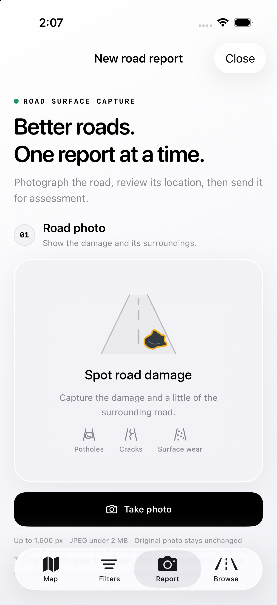

# GeoAI for iOS

A native SwiftUI and MapKit client for the GeoAI road-damage platform. It includes a map dashboard, severity filters, horizontal assessment cards, road and distress icons, and camera reports with capture time and location metadata.

## Run

1. Open `GeoAI.xcodeproj` with **Xcode 26 or newer**. The app targets **iOS 17+**.
2. Select the **GeoAI** scheme and an iPhone simulator, then Run.
3. For a physical iPhone, select your development team in Signing & Capabilities, use a unique bundle identifier as needed, and choose the connected device. No personal signing team is committed.

This build is configured for the supplied GeoAI Supabase project and Cloudinary `dnxpt5gea` cloud with unsigned preset `photos`. It refreshes live observations at launch, retaining the bundled demo and last successful metadata load for fallback. Apple Maps, place search and remote photos need internet access; maps and photos are not fully available offline.

Camera reporting requires a physical device. The simulator shows an explicit message instead of attempting camera startup. The current survey update is **1.0.0 build 13, built and launched in the iPhone simulator with Xcode 27.2**. Native Map and Browse were visually checked on an iPhone 18 Pro simulator running iOS 27.0; Browse reported **361 observations · live data** on October 30, 2026. This is simulator verification, not a physical-iPhone install. The older build 11 launch check in [verification](VERIFICATION.md) does not verify build 13. **Live camera preview, capture and a real upload still require hands-on verification.**

## Experience

- Native Map, Video, Filters, Report and Browse tabs, with Liquid Glass and the selected-tab pill on iOS 26+; earlier releases use system material styling.
- Six map appearances, clustered severity dots, night-capture outlines and a pulse on selection.
- A road overview card that swipes above the tab bar and collapses behind it.
- Assessment cards slide horizontally with Next, Previous or swiping; opening a marker retains the upward entrance.
- Vector road artwork with pothole, crack, alligator-crack, bleeding and surface-wear symbols. Unknown observations keep a neutral road icon.
- Camera-only reporting, protected drafts, image resizing, coordinate review and retry/reconciliation handling.
- Debounced place search, paginated data loads, expert-correction precedence and explicit demo/saved/live indicators.
- Larger default text (Dynamic Type starts at Extra Large and honors larger accessibility settings), 44–60 point controls, and responsive scrolling cards.
- Native loading orbs choose from Composing, Breathing, Weaving, Searching, Solving and Shaping. Each loading view keeps its choice through redraws, theme changes and background/resume. The two live-refresh indicators share one style, changing on the next refresh without an immediate repeat. Status text describes the actual operation. Reduce Motion is respected and orbs pause when inactive, offscreen or in the background. No artificial processing delay or extra feature is added.



## Video survey dashboard

In the hosted survey, Video mode shows only drive routes and drive observations. Tap its Map button to restore walking/citizen observations with their saved filters. Deploy the current shared website to receive this behavior; it does not require a new native iOS build.

The **Video** tab adds the shared GeoAI survey website inside a retained `WKWebView`. The existing native Map, Filters, Browse and camera-report flows remain available. The current dashboard shows all drive routes, a separate total-distance pill, a custom drive menu, the selected drive's route and distress details, and numbered citizen/video clusters that separate as you zoom. Its persistent photo card includes captured-frame browsing and route replay; Next and Play keep the card open, replay focuses the car, and the photo/details stack on phone screens or sit side by side on wider screens. It also retains survey filters, map styles, CSV export and shareable views. Changing tabs retains the survey view and prepared maps. Explicit Reload preserves its current URL/view and revalidates the served HTML so a deployment with updated versioned scripts can be fetched. Website startup handles tile readiness. The native Apple Maps tab continues to use MapKit's own rendering and cache.

Set `GISDashboardURL` in `GeoAI/Resources/Configuration.plist` before distribution, or open **Video → Survey connection** and enter the HTTPS address on the device. The address is saved locally. Use the same server for the updated website at `/gis/app/` and the read-only `/gis/*` API. **No live survey server address is supplied in this repository.** An empty configuration presents setup; it does not substitute a demo or claim a production connection. Deploy the root website from the same source package, including its current HTML, all scripts, styles and fonts, before connecting build 13. The iOS app loads that hosted website; it does not embed a second copy of its assets. Publishing or building the app does not deploy the website or API.

The Video tab opens with `?video=1`, without changing the map's position. Build 13 checks the document's `geoai-survey-ui-version` revision (at least `20261030`), Video control and required GIS, survey, drive-player and inspector script tags. An old/incomplete deployment shows a clear update-and-retry message. This checks compatibility before asynchronous map/data initialization; it does not mistake a still-loading map for an incompatible page. Bounded loading/error states offer Retry or Open in browser. Release builds accept HTTPS only. Debug builds additionally accept loopback HTTP (`localhost`, `127.0.0.1`, `::1`) for an iOS simulator using the local sample server; loopback on a physical phone refers to the phone itself. LAN HTTP is not accepted. `Info-Debug.plist` allows local networking only; release ATS settings remain unchanged.

**Share/export bridge:** the web app dispatches cancelable document events `geoai:share` with `{url,title}` and `geoai:export` with `{url,filename}` or `{content,filename,mime:"text/csv"}`. The native layer accepts main-frame messages from the configured origin only, validates share/download destinations, rejects cross-origin download redirects, caps CSV exports at 10 MiB, and presents the iOS share sheet. Temporary export files are removed after sharing. Outbound HTTPS links open in Safari; Debug builds also allow previews from the exact configured loopback HTTP origin. Arbitrary URL schemes and unrelated HTTP origins are blocked. This is a narrow bridge with no native file-read or database access.

Xcode 27.2 is installed and a full Debug iOS Simulator build succeeded for build 13 on October 30, 2026. The app was installed and launched on the iPhone 18 Pro / iOS 27.0 simulator; native Map tiles/clusters and Browse with live observations were visually verified. Earlier 34 Foundation regression checks, injected bridge and dashboard capability checks, and Swift syntax parsing also passed. Physical-device camera/upload, native sharing/download interactions and the complete hosted Video flow remain to be verified. No signed IPA was produced. See `SURVEY_VERIFICATION.md` for the exact checks and release handoff.

## Connect live data

The four existing capture/citizen service values in `GeoAI/Resources/Configuration.plist` are configured for this build. They are public client settings, including a legacy `anon` key, and will be present in the installed app. `Configuration.example.plist` remains a blank reset template. No privileged server credentials are used.

| Field | Value |
|---|---|
| `SupabaseURL` | HTTPS Supabase project URL |
| `SupabasePublicKey` | Publishable key (`sb_publishable_…`) or legacy `anon` JWT |
| `CloudinaryCloudName` | Cloudinary cloud name |
| `CloudinaryUploadPreset` | Unsigned image-upload preset |
| `GISDashboardURL` | HTTPS URL of the deployed shared survey dashboard, normally `/gis/app/` |

MapKit requires no additional map API key. Keep service-role keys, database passwords, Cloudinary secrets and AI-provider keys on the backend; the iOS client rejects privileged Supabase keys.

The backend must provide public-role reads for the intended `photos` and `assessments` rows, permitted inserts into `photos`, receipt lookups by image URL, the existing assessment trigger/worker, and a suitable unsigned Cloudinary image preset. The bundled `Backend/001_photos_captured_at.sql` migration was applied to the configured project on September 21, 2026; public reads and insert grants were verified. Existing permissions and triggers were preserved. Other projects still need the [capture timestamp setup](Backend/README.md). Publishing this source does not apply migrations automatically.

New photo inserts contain `image_url`, `latitude`, `longitude`, `address` and nullable `captured_at`. The existing `created_at` upload timestamp and FIFO queue ordering remain unchanged. The app uses direct Supabase/Cloudinary interfaces, not the FastAPI expert-review service.

## Capture and draft behavior

Capture time is recorded in the shutter callback. GPS is accepted only if it is within 15 seconds of that event, has valid coordinates and reports accuracy of 150 metres or better. Missing permission or a fresh fix leaves coordinates available for manual entry. Capture time and reviewed coordinates are uploaded; GPS accuracy, fix time and provenance remain in the local draft.

The resized JPEG is at most 1,600 pixels along its longest edge and under 2 MB. Timestamp and geotag are separate report metadata, not a watermark or embedded EXIF in that resized image. The removed library picker cannot import new images; legacy imported drafts remain readable.

The camera waits for an active app, visible view and rendering preview before enabling its shutter. Temporary interruptions pause and resume. A protected local `Library/Application Support/camera-diagnostics.json` snapshot records session/preview state, bounds and error codes only; it contains no media or location data and is excluded from backup.

A single protected draft survives app launches and is excluded from backup. Closing Report saves it. Discarding removes the local draft, not any already-uploaded asset. Interrupted database submissions become **Check submission** and query for an existing receipt before an explicit retry. Full duplicate prevention still requires server-side uniqueness; an interrupted Cloudinary response may leave an unused asset. Keep the app open during submission; background/resumable transfers are not implemented.

Known capture times determine day/night. Explicit null remains unknown. Older schemas/snapshots that omit `captured_at` retain the historical upload-time fallback. The migration does not reconstruct capture times for old records.

## Development and validation

`project.yml` is the XcodeGen source. Run `xcodegen generate` after adding source files outside Xcode. The generated project and shared scheme are committed. `Packages/GeoAICore` contains Foundation-only models, parsing, filtering and REST behavior. `Packages/ThinkingOrbsKit` vendors Jakub Antalik's MIT-licensed native SwiftUI animations at a pinned revision; it has no external runtime dependencies. See its `VENDORED.md` for provenance and local changes.

From this directory, with full Xcode selected:

```sh
DEVELOPER_DIR=/Applications/Xcode.app/Contents/Developer \
  xcrun swift test --package-path Packages/GeoAICore
DEVELOPER_DIR=/Applications/Xcode.app/Contents/Developer \
  bash Scripts/verify-capture.sh
```

Additional scripts: `Scripts/check-catalyst.sh` and `Scripts/check-core.sh`. See [VERIFICATION.md](VERIFICATION.md) for actual checks and remaining hardware/backend work. Complete backend authentication, abuse controls, privacy disclosures and App Store requirements before distribution.

`python3 Scripts/check-services.py` checks public read access and sends deliberately invalid image bytes to Cloudinary to test preset validation without creating an asset. It does not send a real photo or create database rows, and it does not establish end-to-end camera or AI-worker operation.

Based on this repository's design and the [GeoAI backend](https://github.com/Suraj-B12/GeoAI). Original font and snapshot licensing is retained in `UPSTREAM-LICENSE`.
